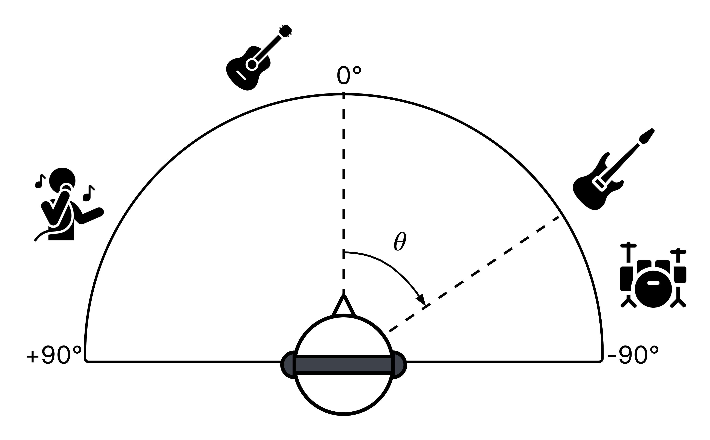
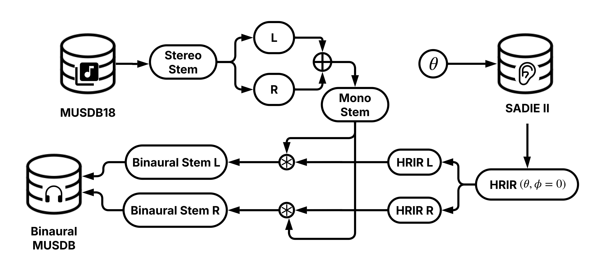

# Binaural Musical Source Separation (MSS)

The accompanying repository for **"Do Music Source Separation Models Preserve Spatial Information in Binaural Audio?"** 
by Richa Namballa, Dr. Agnieszka Roginska, and Dr. Magdalena Fuentes.
> Binaural audio remains underexplored within the music information retrieval community. Motivated by the rising popularity of virtual and augmented reality experiences as well as potential applications to accessibility, we investigate how well existing music source separation (MSS) models perform on binaural audio. Although these models process two-channel inputs, it is unclear how effectively they retain spatial information. In this work, we evaluate how several popular MSS models preserve spatial information on both standard stereo and novel binaural datasets. Our binaural data is synthesized using stems from MUSDB18-HQ and open-source head-related transfer functions by positioning instrument sources randomly along the horizontal plane. We then assess the spatial quality of the separated stems using signal processing and interaural cue-based metrics. Our results show that stereo MSS models fail to preserve  the spatial information critical for maintaining the immersive quality of binaural audio, and that the degradation depends on model architecture as well as the target instrument. Finally, we highlight valuable opportunities for future work at the intersection of MSS and immersive audio.


## Binaural-MUSDB

<center></center>

To perform binaural synthesis, first download [MUSDB18-HQ](https://zenodo.org/records/3338373) and the Head-Related Impulse Responses (HRIRs) for Subject D1 (44.1kHz, 16-bit WAV) from [SADIE II](https://www.york.ac.uk/sadie-project/database.html).

<center></center>

**For randomly placed sources**:

```
python binaural_synth.py \
    /path/to/musdbhq18 \
    /path/to/output/directory \
    /path/to/hrir/directory
```

**Example usage to reproduce Binaural-MUSDB**:

```
python binaural_synth.py \
    data/musdb18hq \
    data/binaural_musdb18 \
    data/D1_HRIR_WAV/44K_16bit \
    data/binaural_musdb_metadata.json
```


## BibTeX Citation

```
@inproceedings{Namballa2025,
  title = {Do Music Source Separation Models Preserve Spatial Information in Binaural Audio?},
  author = {Namballa, Richa and Roginska, Agnieszka and Fuentes, Magdalena},
  booktitle = {Proceedings of the 26th International Society for Music Information Retrieval Conference},
  year = {2025},
  address = {Daejeon, South Korea},
  organization = {ISMIR}
}
```

## References

[1] Z. Rafii, A. Liutkus, F.-R. Stöter, S. I. Mimilakis, and R. Bittner, "MUSDB18-HQ - an uncompressed version of MUSDB18," Dec. 2019. [Online]. Available: https://doi.org/10.5281/zenodo.3338373

[2] C. Armstrong, L. Thresh, D. Murphy, and G. Kearney, "A perceptual evaluation of individual and non-individual HRTFs: A case study of the SADIE II database," _Applied Sciences_, vol. 8, no. 11, p. 2029, 2018.