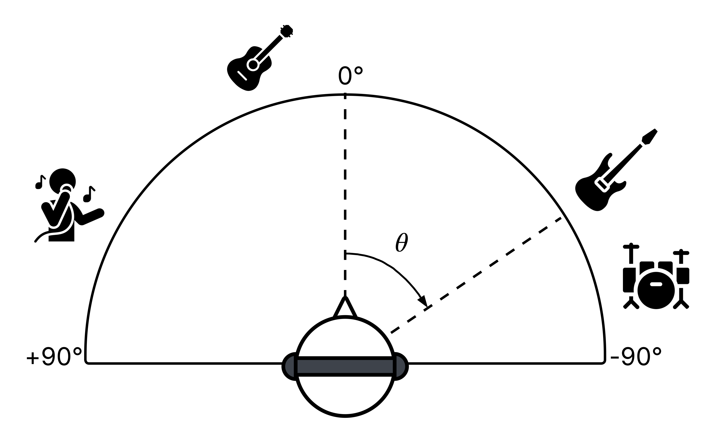
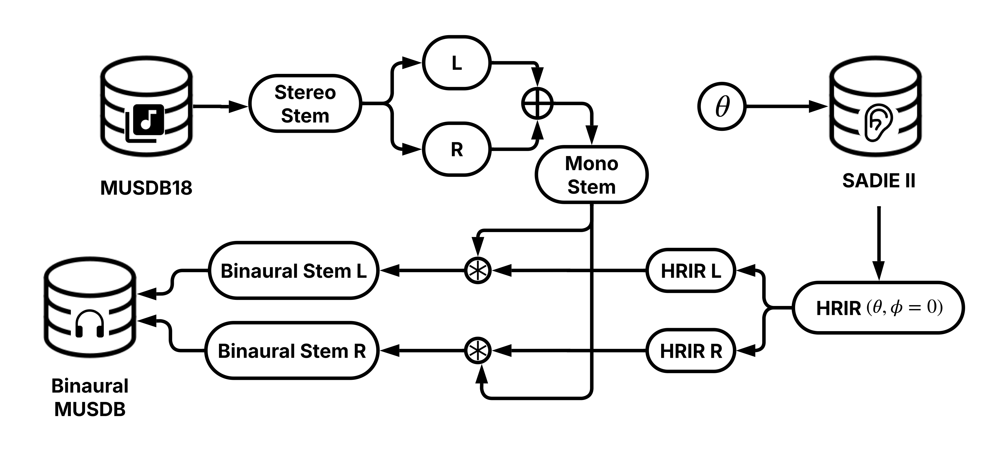

## Binaural-MUSDB

<center></center>

To perform binaural synthesis, first download [MUSDB18-HQ](https://zenodo.org/records/3338373) and the Head-Related Impulse Responses (HRIRs) for Subject D1 (44.1kHz, 16-bit WAV) from [SADIE II](https://www.york.ac.uk/sadie-project/database.html).

<center></center>

**For randomly placed sources**:

```
python binaural_synth.py \
    /path/to/musdbhq18 \
    /path/to/output/directory \
    /path/to/hrir/directory
```

**Example usage to reproduce Binaural-MUSDB**:

```
python binaural_synth.py \
    data/musdb18hq \
    data/binaural_musdb18 \
    data/D1_HRIR_WAV/44K_16bit \
    data/binaural_musdb_metadata.json
```

## References

[1] Z. Rafii, A. Liutkus, F.-R. Stöter, S. I. Mimilakis, and R. Bittner, "MUSDB18-HQ - an uncompressed version of MUSDB18," Dec. 2019. [Online]. Available: https://doi.org/10.5281/zenodo.3338373

[2] C. Armstrong, L. Thresh, D. Murphy, and G. Kearney, "A perceptual evaluation of individual and non-individual HRTFs: A case study of the SADIE II database," _Applied Sciences_, vol. 8, no. 11, p. 2029, 2018.